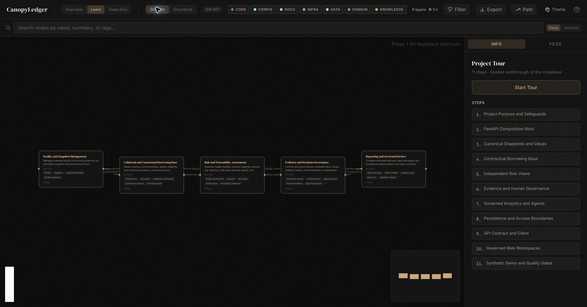

# CanopyLedger

[](LICENSE)

CanopyLedger is an open-source reference application for governed, repeatable borrowing-base
decisions in coffee trade finance. It brings collateral, receivables, evidence, market inputs,
hedges, scenarios, climate and traceability evidence, and human approvals into one auditable
decision record.

It is for learning, prototyping, and integration design. Calculations are reproducible, evidence is
reviewable, and an authorized person makes the final decision. All bundled data is synthetic. Do not
use the reference application with real borrower, farmer, customer, market, credential, or regulated
production data.

## What you can do with it

- Calculate contractual borrowing base and availability from inventory, receivables, reserves, and
  usage.
- Review document-derived evidence, approve or reject candidate facts, and preserve correction and
  supersession history.
- Explore hedge liquidity, scenario capacity, internal risk capacity, credit early-warning signals,
  and climate/traceability evidence readiness without conflating them with the contractual result.
- Create recommendations, request independent approval, record final decisions and overrides, and
  inspect their audit timeline.
- Create immutable decision report packages with a canonical JSON model plus HTML and PDF artifacts.
- Use the FastAPI service directly or explore the same API through the included Next.js web app.

## Key safeguards

CanopyLedger keeps several concepts deliberately separate:

- **Contractual borrowing base (CBB)** is the collateral calculation defined by the facility terms.
- **Internal risk capacity (IRC)** is a risk-management view; it never silently replaces CBB.
- **Evidence candidates** are not approved evidence until a human reviewer accepts them.
- **Recommendations** are advisory; a final decision needs an authorized, independent approver.
- **Current reports** are issued only for the active approved decision. Historical reports remain
  clearly designated as audit records.

The browser displays API-provided results and lineage. It does not calculate authoritative
financial values or create official reports from client state.

## Terms used here

- A **facility** is the lending agreement being reviewed.
- **Collateral** is the inventory or receivables that support that facility.
- The **borrowing base** is the contractual value of eligible collateral after agreed limits and reserves.
- **CBB** is that contractual borrowing base. **IRC** is a separate internal risk view.
- A **snapshot** is a frozen copy of the inputs used for one review.
- Money is returned as strings, such as `"120000.00"`, so clients do not lose decimal precision.

## Architecture

```text
Next.js web app
  Cockpit · Collateral · Evidence · Hedge · Scenarios · Climate · Credit
  Analytics · Agents · Approvals · Reports
                                      |
                                 HTTPS / JSON
                                      |
FastAPI service ── snapshots · evidence · governance · reporting read models
                                      |
              PostgreSQL/PostGIS adapters or in-memory local adapters
                                      |
     deterministic Python engines ── valuation · eligibility · liquidity · scenarios
```

Local experimentation uses in-memory adapters. The durable path uses PostgreSQL, PostGIS,
Alembic migrations, and the integration suite.

### Authority boundaries

| Concern | Authoritative owner | Deliberate boundary |
|---|---|---|
| Facility data and evidence | Reviewed working state and approved facts | Candidate facts and unresolved critical conflicts cannot satisfy a snapshot requirement. |
| Review context | Immutable snapshot plus pinned market, policy, legal-interpretation, and computation bundles | Freezing records inputs and lineage; it does not calculate finance or call external services. |
| Finance calculations | Deterministic Python calculation stages | CBB is contractual; hedge, scenario, credit, climate, and IRC assessments provide separate context. |
| Decision | Authorized independent human approver | A recommendation is not a final decision; an override preserves the original recommendation. |
| Presentation | FastAPI read models and the Next.js application | The browser formats server-issued values and lineage but never recomputes official values. |

## Quick start

### Prerequisites

- Python 3.12 through 3.14
- [uv](https://docs.astral.sh/uv/)
- Node.js 20 or later and npm
- Docker, only for the complete disposable PostgreSQL/PostGIS demonstration and integration gate

### Install

```bash
git clone https://github.com/vinzlercodes/CanopyLedger.git
cd CanopyLedger
uv sync --extra dev
npm --prefix typescript install
npm --prefix apps/web install
```

### Run the full synthetic demonstration

```bash
make demo
```

This starts a disposable PostgreSQL/PostGIS database, loads only synthetic records, applies the
schema migrations, creates an approved decision and its immutable report package, then starts the
API and web app. Open the `/sign-in` address printed by the command, choose a synthetic role, and
open the facility’s **Reports** workspace. Stop the command with Ctrl-C; it removes the disposable
database it created.

Use `make demo-verify` when you want the same end-to-end workflow and report verification without
starting the web servers. See the [demo guide](DEMO.md) for a click-by-click walkthrough, direct API
examples, expected synthetic results, and known limits of the demo.

### Choose your path

| Goal | Start here |
|---|---|
| See both user roles in a populated UI | [Demo walkthrough](DEMO.md#8-detailed-ui-walkthrough) |
| Learn the project from installation to a first contribution | [Getting started and onboarding](docs/ONBOARDING.md) |
| Call the API or use generated client types | [API and client](#api-and-client) |
| Understand the non-negotiable safeguards | [Key safeguards](#key-safeguards) and [contracts](docs/contracts/) |

### How a decision moves through the system

```text
Document → candidate fact → human-reviewed approved fact
                                      │
Working facility ── freeze ──► immutable snapshot + pinned bundles
                                      │
                     deterministic CBB ──► hedge/liquidity, scenarios, IRC,
                                          credit signal, and climate/traceability evidence state
                                      │
                          bounded recommendation ──► independent human decision
                                                                  │
                                                     immutable report package
```

A snapshot carries the inputs and pinned bundles needed to reproduce a review. The system retains
the uncapped, independent CBB and IRC assessments and records the binding constraint for a
recommendation. Candidate evidence, recommendations, analytics, and agents do not become final
authority on their own.

### Business domains



The dashboard map groups the system into five connected business domains:

1. **Facility and snapshot management** turns mutable facility data into an immutable review
   context, including the market, policy, legal-interpretation, and computation bundles needed for
   reproducibility.
2. **Collateral and contractual borrowing base** values inventory and receivables, applies
   eligibility rules and contractual reserves, and produces CBB without informal risk overlays.
3. **Risk and traceability assessment** evaluates hedge liquidity, scenarios, IRC, credit
   early-warning signals, and climate/EUDR evidence readiness as separate, governed assessments.
4. **Evidence and decision governance** preserves the lifecycle from document-derived candidate
   facts through human review, recommendation, independent approval, final decision, correction,
   and override.
5. **Reporting and governed review** compiles immutable decision packages and exposes bounded
   analytics and agent-assisted review without granting those assistants financial or approval
   authority.

### Read the codebase in this order

| Start with | Then trace | What it teaches |
|---|---|---|
| [`src/canopyledger/api/app.py`](src/canopyledger/api/app.py) | application models and request/response contracts | How FastAPI composes the service and its governed read models. |
| [`src/canopyledger/integrity/`](src/canopyledger/integrity/) and [`src/canopyledger/domain/`](src/canopyledger/domain/) | snapshots, canonical values, and money/identifier types | Why frozen inputs, digests, and exact decimals come before calculation. |
| [`src/canopyledger/borrowing_base/`](src/canopyledger/borrowing_base/), [`collateral/`](src/canopyledger/collateral/), and [`receivables/`](src/canopyledger/receivables/) | valuation, eligibility, reserves, and CBB | The contractual collateral path. |
| [`src/canopyledger/hedge/`](src/canopyledger/hedge/), [`scenario/`](src/canopyledger/scenario/), [`credit/`](src/canopyledger/credit/), and [`climate/`](src/canopyledger/climate/) | independent risk assessments | How risk context remains distinct from contractual CBB. |
| [`src/canopyledger/evidence/`](src/canopyledger/evidence/), [`governance/`](src/canopyledger/governance/), and [`reporting/`](src/canopyledger/reporting/) | human review, decisions, and reports | How authority and auditability are preserved after calculation. |
| [`apps/web/`](apps/web/) and [`docs/contracts/`](docs/contracts/) | UI states, API lineage, and invariants | How the presentation layer consumes the governed backend without becoming a calculation authority. |

For a fuller installation, guided tour, architecture map, and complexity hotspots, see
[Getting started and onboarding](docs/ONBOARDING.md).

## Run the application locally

Start the API in one terminal:

```bash
CANOPYLEDGER_DEMO_AUTH_ENABLED=true \
uv run uvicorn canopyledger.api.app:create_app --factory --host 127.0.0.1 --port 8000
```

Confirm it is running:

```bash
curl http://127.0.0.1:8000/health
```

For a populated UI walkthrough without the database pipeline, use the checked-in synthetic workspace
instead:

```bash
uv run uvicorn canopyledger.demo.workspace:create_demo_app --factory --host 127.0.0.1 --port 8000
```

In a second terminal, start the web app with the explicitly enabled local sign-in:

```bash
export CANOPYLEDGER_DEMO_SESSION_SECRET="$(openssl rand -hex 32)"
CANOPYLEDGER_API_BASE_URL=http://127.0.0.1:8000 \
CANOPYLEDGER_DEMO_AUTH_ENABLED=true \
CANOPYLEDGER_DEMO_SESSION_SECRET="$CANOPYLEDGER_DEMO_SESSION_SECRET" \
npm --prefix apps/web run dev
```

Open <http://127.0.0.1:3000/sign-in>. The demo roles and tokens are public synthetic fixtures, not
an authentication design. They are disabled by default and may be enabled only for a loopback,
synthetic demonstration. Do not expose this API to a network or connect it to real data. The web
server forwards the selected synthetic identity to FastAPI, where authorization remains enforced.

## Reports

Reports are compiled from a frozen snapshot, published outputs, a recommendation, and an approved
final decision. The canonical report model is JSON; HTML and PDF are derived, immutable artifacts.
Each package records its input and output digests, renderer metadata, and whether it is the current
official report or a retained historical audit report.

Use the Reports workspace to inspect a package and download its HTML or PDF artifact. Integrations
can create a package with `POST /api/v1/decisions/{decision_id}/reports`, list packages with
`GET /api/v1/decisions/{decision_id}/reports`, and download an artifact from
`GET /api/v1/reports/{report_id}/artifacts/{format}`. The detailed [reporting guide](docs/reporting.md)
explains the report lifecycle and reproducibility guarantees.

## API and client

The live schema is available at `/openapi.json`; the versioned checked-in contract is
[docs/api/openapi-v1.json](docs/api/openapi-v1.json). A generated TypeScript client is kept in
[`typescript/generated`](typescript/generated/).

The most useful starting points are:

- `GET /health` for service status.
- `POST /api/v1/cbb-certificates/demo` for a synthetic borrowing-base calculation.
- Evidence document and candidate-fact endpoints for the review workflow.
- Snapshot-scoped Cockpit, Collateral, Evidence, Hedge, Scenario, Climate, Approval, and Reports
  read models for UI or integration use.

API callers must treat monetary values and other authoritative decimals as strings, retain returned
lineage fields, and keep authorization on the server side.

## Verification

Run the standard local checks:

```bash
make verify
npm --prefix typescript run typecheck
npm --prefix typescript test
npm --prefix apps/web run typecheck
npm --prefix apps/web test
npm --prefix apps/web run test:e2e
CANOPYLEDGER_NEXT_DIST_DIR=.next-e2e npm --prefix apps/web run build
```

`pytest` skips tests that require PostgreSQL when `DATABASE_URL` is unset. To run the full durable
acceptance gate with Docker, use:

```bash
make test-postgres
```

The command provisions an isolated PostGIS database, runs migrations and database checks, executes
the PostgreSQL-marked tests, then removes the database.

## Documentation

- [Getting started and onboarding](docs/ONBOARDING.md): choose a demo, integration, or contribution path and learn the core business flow.
- [Demo guide](DEMO.md): install, API, UI, and report-package walkthrough.
- [Reporting guide](docs/reporting.md): report lifecycle, artifacts, and reproducibility.
- [Synthetic data card](docs/data-card.md): what the bundled fixtures are and are not.
- [API contract](docs/api/openapi-v1.json): versioned OpenAPI document.
- [Contributing guide](CONTRIBUTING.md): development setup and contribution expectations.
- [Code of conduct](CODE_OF_CONDUCT.md): expectations for a respectful community.
- [Support](SUPPORT.md): where to get help and what to include in a question.
- [Security policy](SECURITY.md): reporting a vulnerability and handling sensitive data.
- [Changelog](CHANGELOG.md): changes on the default branch and historical releases.

## Repository layout

```text
apps/web/                   Next.js presentation layer
src/canopyledger/api/       FastAPI routes and API models
src/canopyledger/*/         Domain engines and durable adapters
src/canopyledger/reporting/ Canonical report models and renderers
typescript/                 Shared canonical utilities and generated API client
migrations/                 Alembic database migrations
docs/                       User, integration, and release documentation
tests/                      Unit, API, UI, and PostgreSQL integration tests
```

## Scope and limitations

CanopyLedger is not a core-banking system, market-data terminal, trading platform, legal compliance
service, or autonomous credit engine. Climate and traceability output describes evidence readiness;
it does not certify legal compliance or deforestation-free status. The project has no production
identity-provider, secrets-management, operational-monitoring, or regulatory deployment setup.
It must not be exposed to a network or used with real data.

## Contributing and security

Contributions are welcome. Please read [CONTRIBUTING.md](CONTRIBUTING.md) before opening a pull
request. Do not include vulnerabilities, real financial data, sensitive documents, or credentials
in public issues; follow [SECURITY.md](SECURITY.md) instead.

## License

Copyright © CanopyLedger contributors. Licensed under [Apache-2.0](LICENSE).
